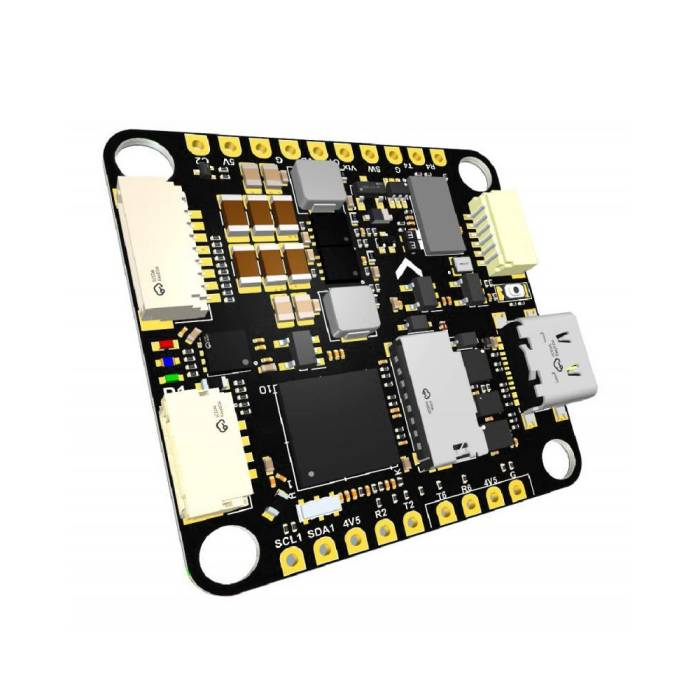
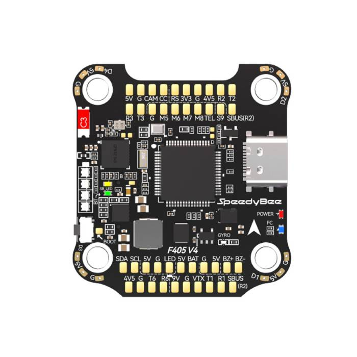

# uf-bsp

[](https://github.com/jettify/uf-bsp/actions/workflows/CI.yml)
[](https://github.com/jettify/uf-bsp/blob/master/LICENSE)

Embassy-based, `no_std` board support for flight controllers, robotics, and prototyping.
Requires Rust 1.92 or newer.

**Experimental:** These crates are under active development. APIs and behavior may change at any time without notice.

| Crate | Board | API docs |
| --- | --- | --- |
| [tbs-lucid-h7-bsp](https://crates.io/crates/tbs-lucid-h7-bsp) | [TBS Lucid H7](tbs-lucid-h7-bsp/README.md), STM32H743 | [docs.rs](https://docs.rs/tbs-lucid-h7-bsp) |
| [speedybee-f405-v4-bsp](https://crates.io/crates/speedybee-f405-v4-bsp) | [SpeedyBee F405 V4](speedybee-f405-v4-bsp/README.md), STM32F405 | [docs.rs](https://docs.rs/speedybee-f405-v4-bsp) |
| [uf-bsp-core](https://crates.io/crates/uf-bsp-core) | Shared metadata, USB helpers, and diagnostics | [docs.rs](https://docs.rs/uf-bsp-core) |

| TBS Lucid H7 | SpeedyBee F405 V4 |
| :---: | :---: |
|  |  |

## Features

- Board pin mappings, clock presets, and DMA resources.
- IMU SPI, async DRDY inputs, barometer I2C, and ADC resources.
- USB CDC, receiver UARTs, OSD, storage, and motor output pins.
- Interrupt binding macros and access to unassigned peripherals.
- Optional board self-checks with USB serial reports.

## Examples

Both boards include:

| Example | Purpose | Required feature |
| --- | --- | --- |
| `blinky` | LED output | — |
| `imu_spi` | IMU FIFO sampling at 1 kHz | `sensor-examples` |
| `baro_i2c` | Pressure and temperature readings | `sensor-examples` |
| `self_check` | Peripheral identities, ADC, status LEDs, and USB reports | — |

Lucid also includes `usb_serial` and `clock_report`.

```sh
cargo build --release -p tbs-lucid-h7-bsp --target thumbv7em-none-eabihf --example imu_spi --features sensor-examples
cargo build --release -p speedybee-f405-v4-bsp --target thumbv7em-none-eabihf --example imu_spi --features sensor-examples
```

Flash USB self-check firmware with `just self-check lucid-h7` or
`just self-check speedybee-f405-v4`.

## License

Licensed under [Apache-2.0](LICENSE).
