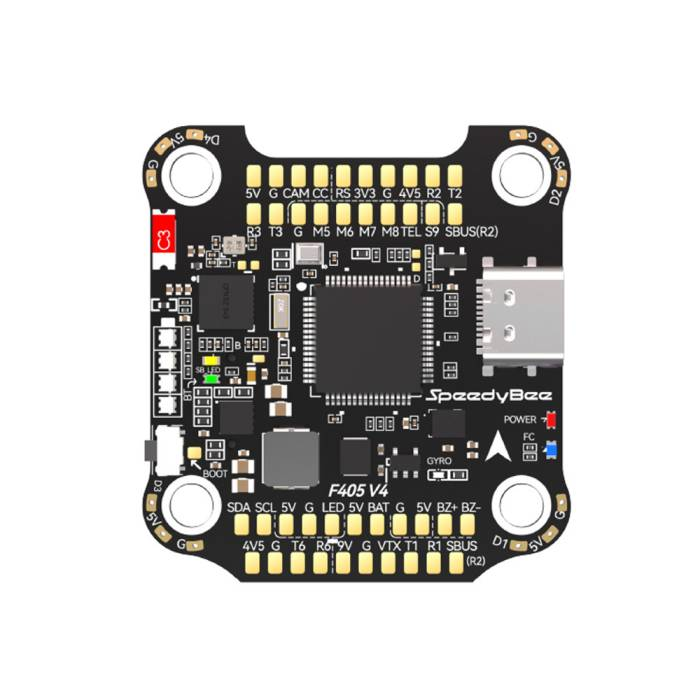

# speedybee-f405-v4-bsp

[](https://github.com/jettify/uf-bsp/actions/workflows/CI.yml)
[](https://crates.io/crates/speedybee-f405-v4-bsp)
[](https://docs.rs/speedybee-f405-v4-bsp)
[](https://github.com/jettify/uf-bsp/blob/master/LICENSE)

Embassy-based, `no_std` board support for the **[SpeedyBee F405 V4 (STM32F405)](https://www.speedybee.com/speedybee-f405-v4-bls-55a-30x30-fc-esc-stack/)**.
Rust 1.92+ · `thumbv7em-none-eabihf` · DFU flashing.



## Features

- SPI1 IMU resources with DMA and async DRDY input.
- Barometer I2C and ADC1 resources, with independent IMU RX and ADC DMA streams.
- USB CDC, USART2 receiver, additional UARTs, OSD SPI2, and SD card SPI3 resources.
- LED, motor output pins, board metadata, and unassigned peripherals.
- Clock presets for 168 MHz CPU and USB; Embassy time driver on TIM9.
- Optional `sensor-examples` drivers.

```toml
[dependencies]
speedybee-f405-v4-bsp = "0.1.0"
```

## Examples

```rust
#![no_std]
#![no_main]

#[path = "support/usb_logger.rs"]
mod usb_logger;

use bsp::hal::gpio::Level;
use bsp::hal::gpio::Output;
use bsp::hal::gpio::Speed;
use embassy_time::Duration;
use embassy_time::Timer;
use panic_halt as _;
use speedybee_f405_v4_bsp as bsp;

#[embassy_executor::main]
async fn main(spawner: embassy_executor::Spawner) {
    let p = bsp::hal::init(bsp::config_with_usb());
    let board = bsp::Board::new(p);
    let mut led0 = Output::new(board.leds.led0, Level::Low, Speed::Low);
    let log = usb_logger::spawn_default(&spawner, board.usb, "SpeedyBee F405 USB Logger");
    log.wait_startup().await;
    log::info!("logging online; starting blinky loop");

    let mut tick: u32 = 0;

    loop {
        led0.toggle();
        tick = tick.wrapping_add(1);
        log::info!("blinky tick={}", tick);
        Timer::after(Duration::from_millis(250)).await;
    }
}
```

| Example | Purpose | Required feature |
| --- | --- | --- |
| `blinky` | LED output | — |
| `imu_spi` | IMU FIFO sampling at 1 kHz, USB logging | `sensor-examples` |
| `baro_i2c` | Pressure and temperature readings | `sensor-examples` |
| `self_check` | Peripheral checks and USB reports | — |

From the workspace root:

```sh
cargo build --release -p speedybee-f405-v4-bsp --target thumbv7em-none-eabihf --example imu_spi --features sensor-examples
```

For USB diagnostics over DFU: `just self-check speedybee-f405-v4`.

[Example sources](https://github.com/jettify/uf-bsp/tree/master/speedybee-f405-v4-bsp/examples)

## License

Licensed under [Apache-2.0](https://github.com/jettify/uf-bsp/blob/master/LICENSE).
