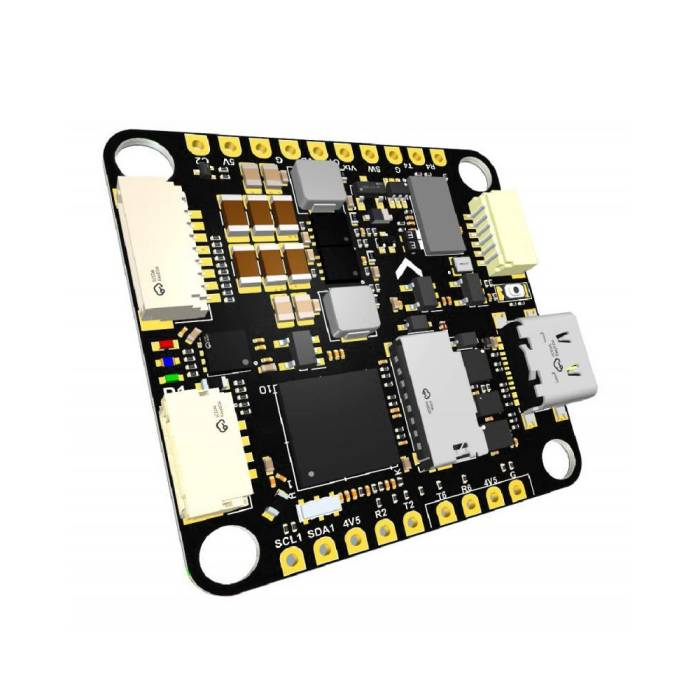

# tbs-lucid-h7-bsp

[](https://github.com/jettify/uf-bsp/actions/workflows/CI.yml)
[](https://crates.io/crates/tbs-lucid-h7-bsp)
[](https://docs.rs/tbs-lucid-h7-bsp)
[](https://github.com/jettify/uf-bsp/blob/master/LICENSE)

Embassy-based, `no_std` board support for the [**TBS Lucid H7 (STM32H743)**](https://www.team-blacksheep.com/products/prod:lucid_h7).
Rust 1.92+ · `thumbv7em-none-eabihf` · SWD or DFU flashing.

**Experimental:** This crate is under active development. APIs and behavior may change at any time without notice.



## Features

- Primary SPI1 and secondary SPI4 IMU resources with DMA and async DRDY inputs.
- Barometer I2C, ADC1/ADC3, and battery/current sensing pins.
- USB CDC, USART6 receiver, additional UARTs, OSD SPI2, and SDMMC resources.
- LEDs, motor output pins, board metadata, and unassigned peripherals.
- Clock presets for 480 MHz CPU and USB; Embassy time driver on TIM12.
- Optional `sensor-examples` drivers.

```toml
[dependencies]
tbs-lucid-h7-bsp = "0.1.0"
```

## Examples

```rust
#![no_std]
#![no_main]

use bsp::hal::gpio::Level;
use bsp::hal::gpio::Output;
use bsp::hal::gpio::Speed;
use cortex_m as _;
use defmt::info;
use defmt_rtt as _;
use embassy_time::Duration;
use embassy_time::Timer;
use panic_probe as _;
use tbs_lucid_h7_bsp as bsp;

#[embassy_executor::main]
async fn main(_spawner: embassy_executor::Spawner) {
    info!("starting blinky example");
    let p = bsp::hal::init(bsp::config());
    let board = bsp::Board::new(p);

    let mut led0 = Output::new(board.leds.led0, Level::Low, Speed::Low);
    let mut led1 = Output::new(board.leds.led1, Level::High, Speed::Low);
    info!("leds initialized");

    loop {
        led0.toggle();
        led1.toggle();
        info!("leds toggled");
        Timer::after(Duration::from_millis(250)).await;
    }
}

```

| Example | Purpose | Required feature |
| --- | --- | --- |
| `blinky` | LED output | — |
| `imu_spi` | IMU FIFO sampling at 1 kHz, RTT logging | `sensor-examples` |
| `baro_i2c` | Pressure and temperature readings | `sensor-examples` |
| `self_check` | Peripheral checks and USB reports | — |
| `usb_serial` | USB CDC serial | — |
| `clock_report` | Clock configuration report | — |

From the workspace root:

```sh
cargo build --release -p tbs-lucid-h7-bsp --target thumbv7em-none-eabihf --example imu_spi --features sensor-examples
probe-rs run --chip STM32H743VIHx target/thumbv7em-none-eabihf/release/examples/imu_spi
```

For USB diagnostics over DFU: `just self-check lucid-h7`.

[Example sources](https://github.com/jettify/uf-bsp/tree/master/tbs-lucid-h7-bsp/examples)

## License

Licensed under [Apache-2.0](https://github.com/jettify/uf-bsp/blob/master/LICENSE).
